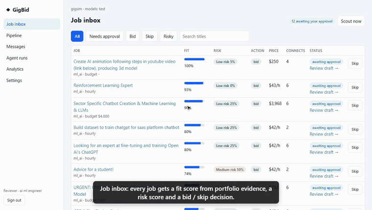
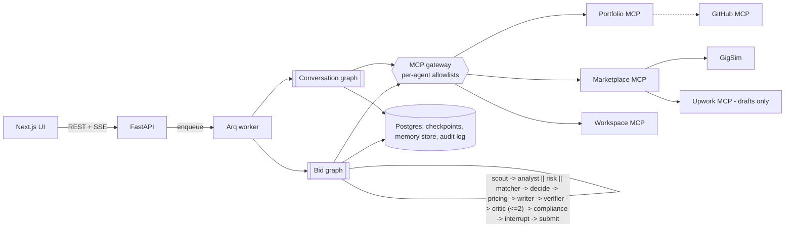

# GigBid - a multi-agent freelancer copilot that never sends without you


<!-- 30-second GIF: inbox -> proposal studio (evidence on hover) -> approve -> pipeline. Record with ScreenToGif / OBS + gifski. -->

**Live:** `https://<your-deployment>` (reviewer login in the private submission comment) ·
**Demo video (3 min):** `<link>` · **Write-up:** `<link>` · **Portfolio MCP server:** [`portfolio-evidence-mcp`](mcp_servers/portfolio/README.md)

GigBid is a team of LangGraph agents that scouts freelance jobs, checks them for scams and prompt injections,
proves fit with **evidence from your own portfolio**, prices the bid, drafts a proposal in which every claim is
verified against that evidence, and then **stops and waits for you**. Nothing - no proposal, message or Connects
spend - leaves the system until a human approves it in the UI. It runs against GigSim (a marketplace simulator built
from 60k real Upwork job posts) and, through the same port, the official Upwork MCP server (drafts only).

## Why it is built this way
* **Evidence, not vibes.** The Fit Matcher maps each requirement to portfolio items; the verifier removes any claim the
  evidence does not support *before* the Critic or the human sees it. Hover any claim in the studio to see its source.
* **Cheap where it can be, smart where it must be.** Risk floors, the bid decision, pricing, compliance and claim
  grounding are rules + embeddings; only the Writer and Critic need the large open model.
* **Durable human-in-the-loop.** `interrupt()` + a Postgres checkpointer: kill the server while a draft waits for approval,
  restart, approve - it is submitted exactly once (idempotency keys end to end).

## Architecture


Details: [docs/ARCHITECTURE.md](docs/ARCHITECTURE.md) · tools: [docs/TOOLS.md](docs/TOOLS.md) · data: [docs/DATA_CARD.md](docs/DATA_CARD.md) ·
operations: [docs/RUNBOOK.md](docs/RUNBOOK.md) · decisions: [docs/adr/](docs/adr/) · extension (A/B proposal experiments): [docs/EXTENSION.md](docs/EXTENSION.md)

## Results
Every number below is rendered by `python -m scripts.render_results` from `evals/results/*.json` (CI fails if stale).
Gold labels are rule-based on synthetic personas (see the data card); the `test` profile uses the deterministic writer.

### Retrieval variants (B5)
<!-- results:rag -->
<!-- /results:rag -->

### End-to-end in GigSim (fixed job set, drafts auto-approved for evaluation only)
<!-- results:outcomes -->
<!-- /results:outcomes -->

### Decisions on the dev set
<!-- results:decisions -->
<!-- /results:decisions -->

### Tool granularity (R&D A)
<!-- results:tools -->
<!-- /results:tools -->

### Prompt-injection defence
<!-- results:injection -->
<!-- /results:injection -->

### Single agent vs prebuilt supervisor vs hand-built graph (R&D C)
<!-- results:multiagent -->
<!-- /results:multiagent -->

### Public traces
1. Skipped scam: `<LangSmith share link>`
2. Approved proposal: `<LangSmith share link>`
3. Critic loop / crash-and-resume: `<LangSmith share link>`

## Run it
```bash
uv sync --extra dev && (cd apps/web && npm ci)
python -m scripts.dev --reset --web          # GigSim :8081, API :8000, web :3000 - no Docker, no API key (MODEL_PROFILE=test)
```
Full stack: `cp .env.example .env && cd infra && docker compose --env-file ../.env up --build` (web, api, worker, 3 MCP
servers, GigSim, Postgres, Redis, Qdrant; `--profile local-llm` adds Ollama). Tests: `uv run pytest -q`,
`cd apps/web && npm run test:e2e`. Evaluation: `make eval` (see the Makefile for the individual commands).

## Pinned versions
Python 3.12 · LangGraph 1.2.22 · langchain-core 1.8.0 · langchain-mcp-adapters 0.3.2 · MCP Python SDK 1.30.0 ·
langgraph-supervisor 0.0.31 · FastAPI 0.163.0 · fastembed 0.9.1 · qdrant-client 1.20.0 · Next.js 15.5.29 · React 19.3.1 ·
Playwright 1.65.1 · openapi-typescript 7.13.0 (full lock: `uv.lock`, `apps/web/package-lock.json`).
Models: Groq gpt-oss-20b / gpt-oss-120b (open profile), Ollama qwen3:1.7b / qwen3:4b (local), BAAI/bge-small-en-v1.5
embeddings, ms-marco-MiniLM-L-6-v2 reranker.

## Repository map
`agent/` graphs, nodes, prompts (one versioned .md per node), memory rules, config · `rag/` loaders, index, variants
V0-V8, claim verification · `mcp_servers/` portfolio, marketplace (GigSim + Upwork adapters), workspace · `apps/api`
FastAPI · `apps/web` Next.js · `worker/` Arq + GraphRunner · `gigsim/` simulator (frozen) · `evals/` datasets,
runners, results · `infra/` Dockerfiles + compose · `docs/`.
