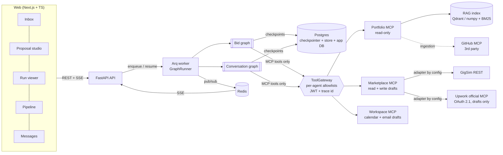
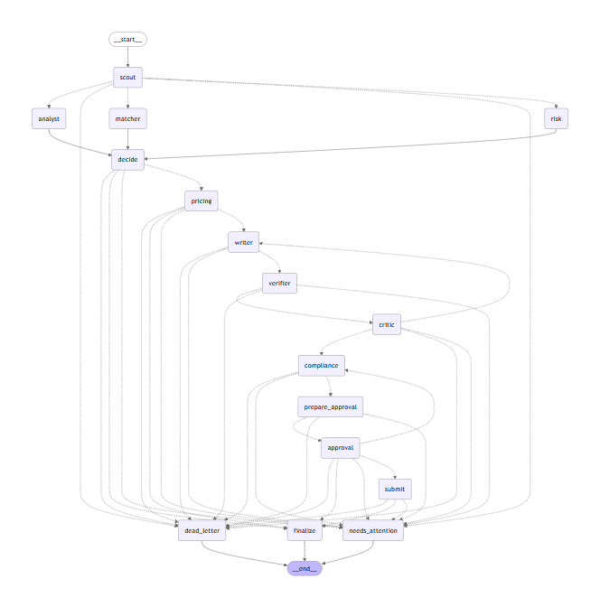
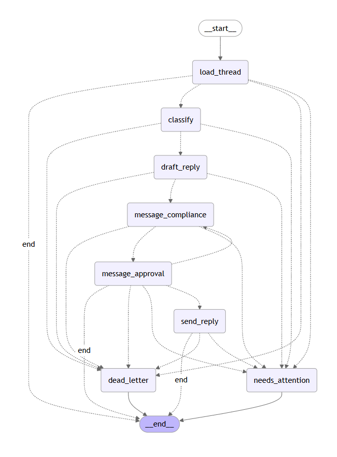

# Architecture

## One picture



## Bid graph (one thread per job) - rendered from code (`docs/images/bid_graph.mmd`)



Summary of the same graph:

```
scout ──► [ analyst ‖ risk ‖ matcher ]  (Send: run in parallel, fan-in at decide)
       ──► decide ──skip/watch──► finalize
              │bid
              ▼
           pricing ──Connects not worth it──► finalize (watch)
              ▼
           writer ──► verifier ──► critic ──revise (≤ 2)──► writer
                                     │pass
                                     ▼
                                 compliance ──block──► needs_attention (reason shown in UI)
                                     ▼
                              prepare_approval (dry_run preview)
                                     ▼
                         approval = interrupt()  ──edit──► compliance (re-check)
                           │approve        │reject
                           ▼               ▼
                        submit          finalize
  every router: step/token budget exceeded ─► needs_attention ; repeated failure ─► dead_letter
```

## Conversation graph (one thread per client conversation)




```
load_thread ──► classify (question | negotiation | interview_request | scam_signal)
            ──► draft_reply (workspace.free_slots for interviews, portfolio evidence for questions,
                             floor price for negotiations, polite on-platform refusal for scam signals)
            ──► message_compliance ──► message_approval = interrupt() ──edit──► message_compliance
                                                      │approve
                                                      ▼
                                   send_reply (idempotent) + tentative interview hold + pipeline stage
```

## Why each agent exists

| Agent | Why it is a separate node | Model (open profile) | MCP access |
|---|---|---|---|
| Scout (worker job + `scout` node) | scheduling, de-duplication and rate limits are not an LLM problem | none | marketplace read |
| Job Analyst | turns free text into a typed `JobSpec` the Writer and Critic share | gpt-oss-20b | none |
| Risk Assessor | rules give a floor injected text cannot argue away; the small model adds judgement | rules + gpt-oss-20b | marketplace read (client history) |
| Fit Matcher | maps every requirement to evidence; the fit score is computed, not guessed | none (RAG pipeline) | portfolio read |
| decide | thresholds in config, explainable reasons, autonomy rule (auto-skip only) | none | none |
| Pricing Strategist | market stats + client spend + floor + Connects expected value | none | marketplace read |
| Proposal Writer | the only node that needs the strongest model | gpt-oss-120b | portfolio read |
| verifier (claim verification, B3) | cheap, deterministic grounding before any human reads the draft | embeddings + lexical | portfolio read |
| Critic | grounding / personalisation / length; bounded loop (max 2 revisions) | rules + gpt-oss-120b | portfolio read |
| Compliance Guard | enforces the policy pack + config `bidding_rules`; can block | rules + gpt-oss-20b | none |
| approval / submit | human gate (interrupt) and the only node allowed to write, with idempotency keys | none | marketplace write (allowlisted) |
| Client Liaison (conversation graph) | intent, slots, replies; same approval gate | rules + gpt-oss-20b / 120b | marketplace read + write after approval, workspace |

Analyst, Risk Assessor and Fit Matcher run in parallel via `Send` - they need only the job, not each other. The
Fit Matcher extracts requirements deterministically (`agent/requirements.py`) so it does not wait for the Analyst.

## State, execution trace and memory are kept apart (C2)

| | Where | What | Written by |
|---|---|---|---|
| **State** | `agent/state.py` (`BidState`, `ConversationState`), checkpointed in Postgres | what this job / conversation needs now: job, analyses, evidence, decision, price, drafts, critiques, approvals, outcome, usage | graph nodes, with reducers wherever parallel branches write (`merge_evidence`, `merge_usage`, `merge_status`, list append) |
| **Execution trace** | MCP `mcp_audit_log` (append-only), `run_events` table, LangSmith | every tool name, arguments, result, node start/finish, latency, tokens | MCP servers, GraphRunner, LangChain tracer |
| **Long-term memory** | LangGraph store: `("style", user)`, `("style_candidates", user)`, `("outcome", user)` | only promoted knowledge: style rules from repeated edits, per-category outcome insights | `agent/memory/promotion_rules.py` only - raw tool output never reaches memory |

## Hand-offs are typed (C3)
`agent/handoffs.py`: `JobSpec`, `RiskReport`, `FitReport` (+ `RequirementMatch`), `BidDecision`, `PriceQuote`,
`ProposalDraft` (+ `Claim`, `ScreeningAnswer`), `VerificationReport`, `Critique`, `ComplianceVerdict`,
`DryRunPreview`, `ApprovalDecision`, `ClientIntent`, `LiaisonDraft`. State stores them as dicts; every node
re-validates on read.

## The marketplace port (R1)
`agent/marketplace_port.py` is the only interface the graphs use. Its implementation calls the Marketplace MCP
server, which picks `adapters/gigsim.py` or `adapters/upwork_live.py` from `marketplace.mode`. Switching to live
mode changes **config only**; no node knows which marketplace it talks to.

## Durability (C6) and failure handling (C7)
* Postgres checkpointer (`AsyncPostgresSaver`); SQLite locally. Approvals are read from checkpoints, so a page
  refresh or an API/worker crash never loses one. Side effects run in `submit`, a separate node **after**
  `approval` (a node that called `interrupt()` re-runs from its start on resume), with idempotency keys
  `"{thread}:v{version}:create|submit"` stored by the Marketplace server and forwarded to GigSim.
* Replay any job from any checkpoint: run viewer -> "Replay" (`aget_state_history` + `checkpoint_id`).
* Every node: budget gate, timeout, bounded retries with backoff, dead-letter. Cheap nodes have a fallback model
  and a deterministic last resort. A marketplace outage raises `MarketplaceDown`: the run stops at its last
  checkpoint, the UI shows the degraded banner, and the runner retries with backoff (20 s, 60 s, 180 s, 600 s).

## Stores
Postgres (app tables, checkpoints, LangGraph store, MCP audit + idempotency), Redis (Arq queue, UI pub/sub,
rate limiter), Qdrant (dense vectors per persona; BM25 in-process), Ollama (optional local models).
