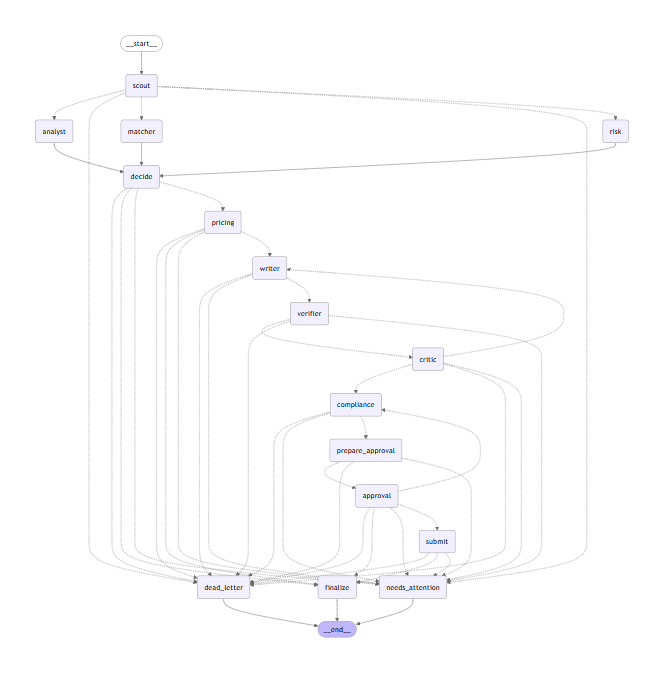
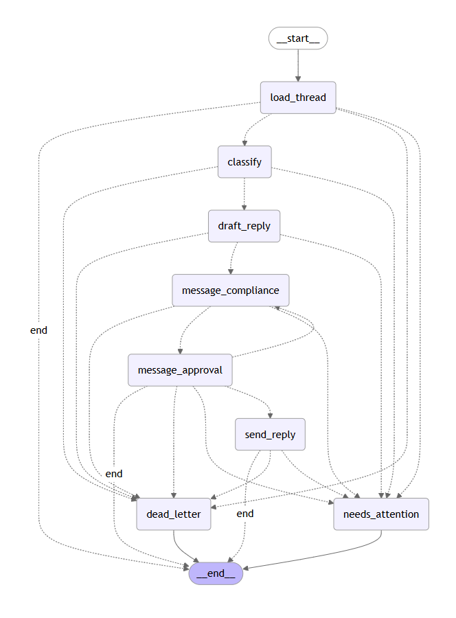

# GigBid - R&D report (AI-4016, Assignment II)

**A multi-agent freelancer copilot: LangGraph, MCP, advanced RAG and a web UI, with a human approving every send.**
Engineering design review. Every number cites a file in `evals/results/` (commit in each file's `meta.git_sha`).
Repository: `gigbid` (README) · live URL and reviewer login: submission comment.

**Read this first - what is real and what is synthetic.** The starter kit shipped without GigSim, persona corpora or a
dev set. GigSim (`gigsim/`) was therefore built from the instructor-listed Kaggle Upwork datasets (60k real job posts:
titles, descriptions, skills, client attributes, Connects; 1.3M contracts and 250k postings for price statistics) plus
labelled synthetic data: three personas, scams, prompt injections, reposts, client preferences and rule-based gold labels
(`docs/DATA_CARD.md`). All experiments ran on an 8-thread laptop CPU (no GPU, no paid API). LLM-dependent studies use
Qwen3-1.7B through Ollama at small n; every runner reproduces at full size with the hosted `open` profile (`make eval-llm`).

{{STATIC_1_2}}

{{SECTION_3}}

{{SECTION_4}}

{{SECTION_5}}

{{SECTION_6}}

{{SECTION_7}}

{{SECTION_8}}

{{STATIC_9}}

{{SECTION_10}}

## Appendix A - reproduce
`python -m scripts.generate_personas && python -m scripts.build_gigsim_data` (data) · `make eval` (retrieval, decisions,
GigSim outcomes, A/B) · `make eval-llm` (injection, tool granularity, multi-agent comparison, judge) ·
`python -m scripts.render_results` (README tables) · `uv run pytest -q` · `cd apps/web && npm run test:e2e`.

## Appendix B - AI usage
Claude Code was used as a pair-programmer; `docs/AI_USAGE.md` lists the files and fifteen mistakes it made that were
caught, among them a retry wrapper that swallowed LangGraph's `GraphInterrupt`, a cross-encoder that could not grade
evidence, a V0 baseline that skipped every job, a model router that mislabelled primary calls as fallbacks, and an
evaluation runner that sampled every skip-labelled job (section 5).

## Appendix C - both graphs, rendered from code
`python -m scripts.render_graphs` builds each graph and writes `graph.get_graph().draw_mermaid()` to `docs/images/*.mmd`
and a drawing to `*.png`; `--check` fails when the committed files no longer match the code.

**Bid graph** (one thread per job):  

**Conversation graph** (one thread per client conversation):  

